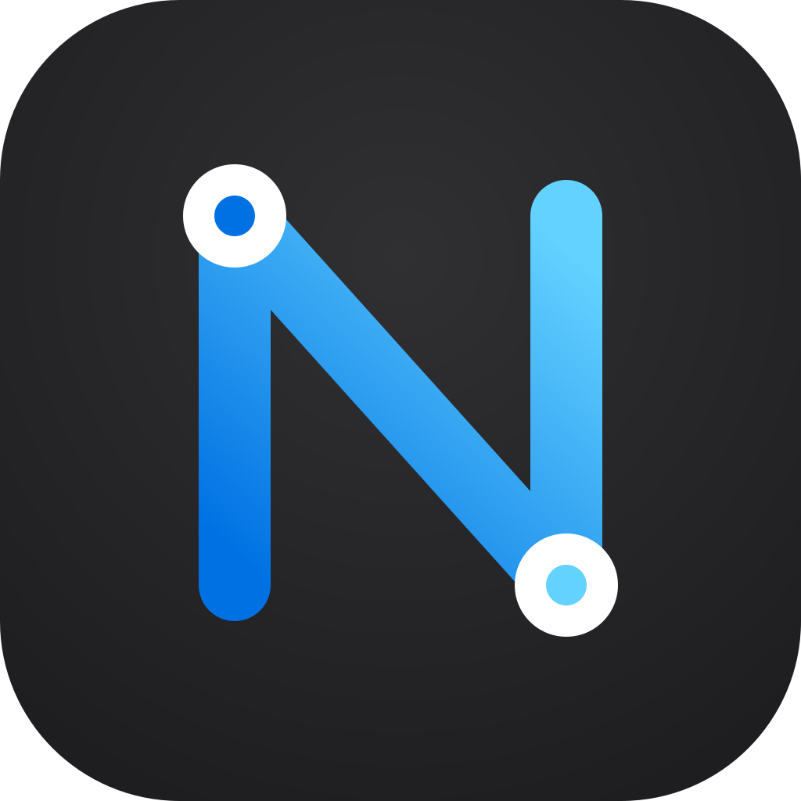
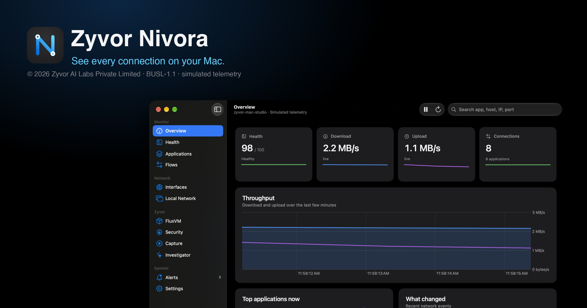
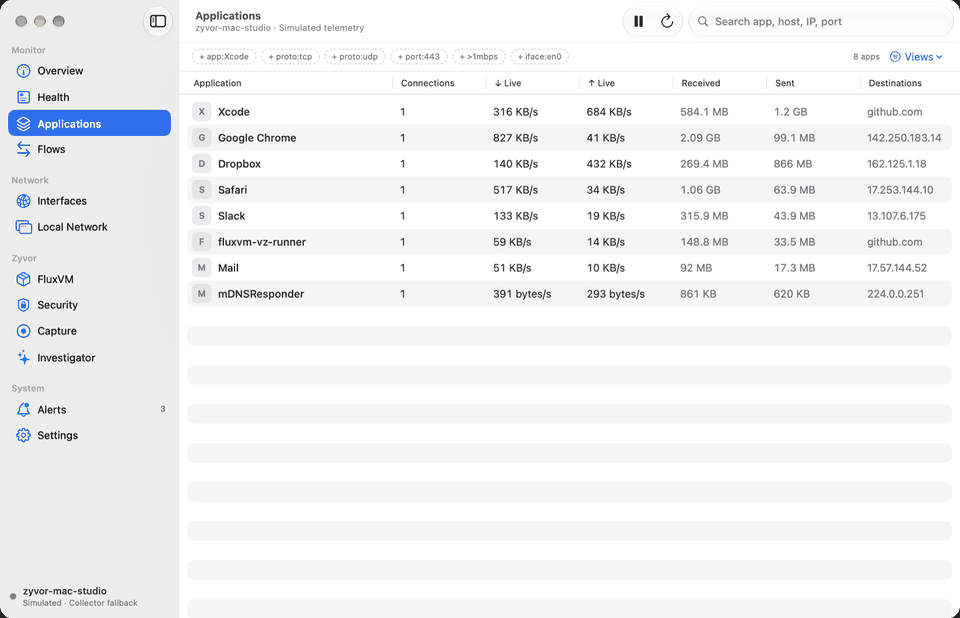
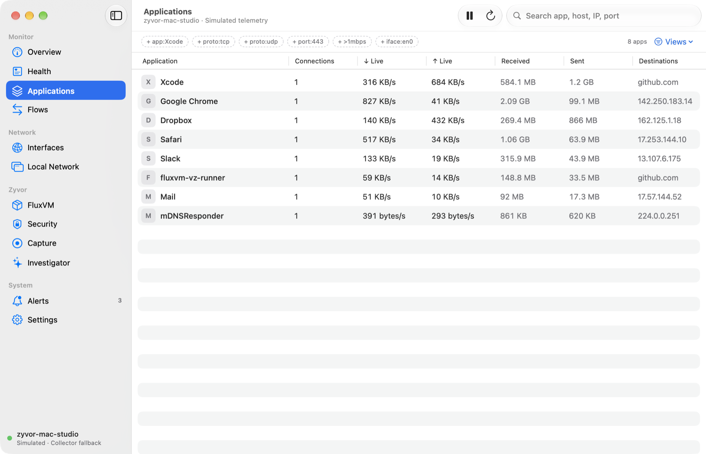
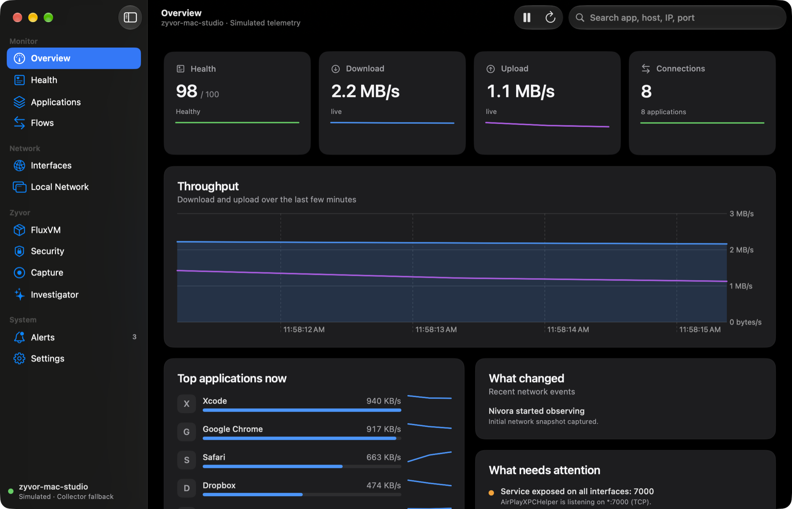
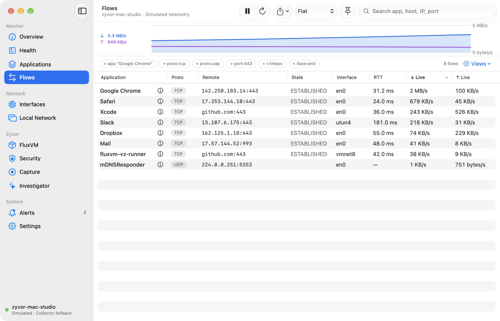
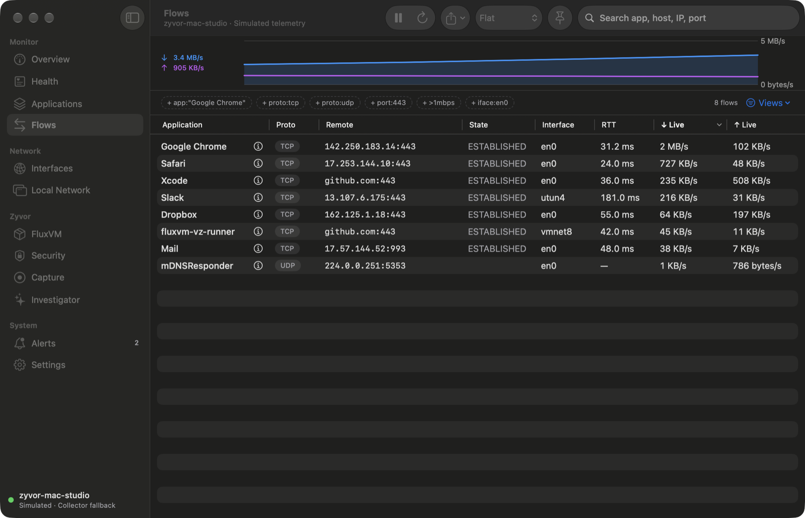
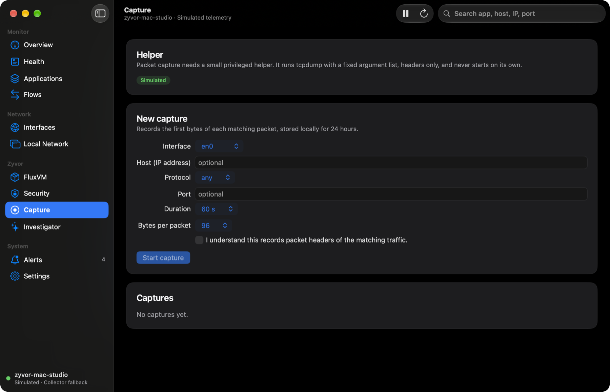
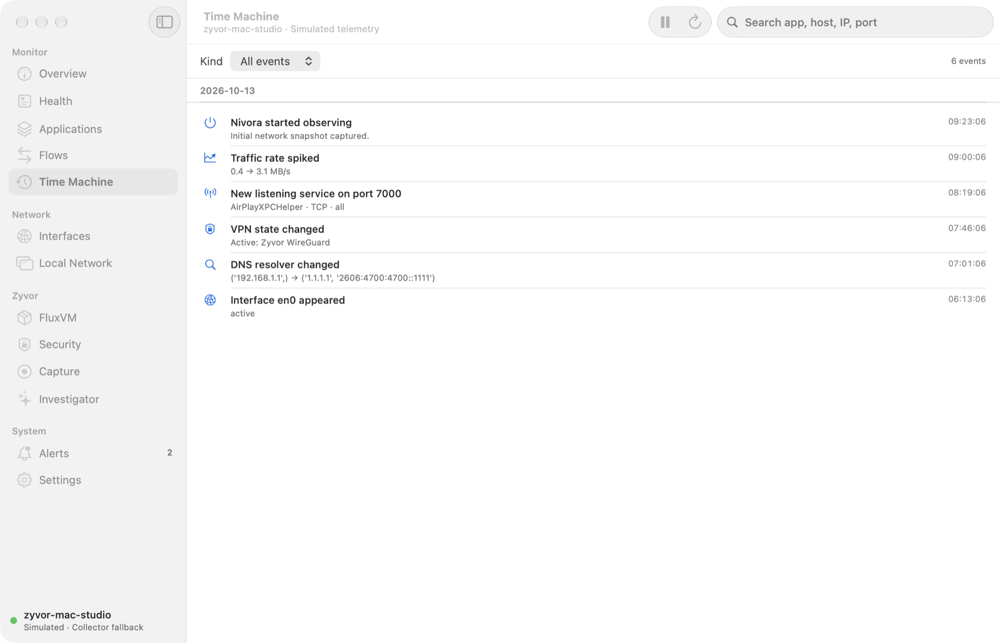
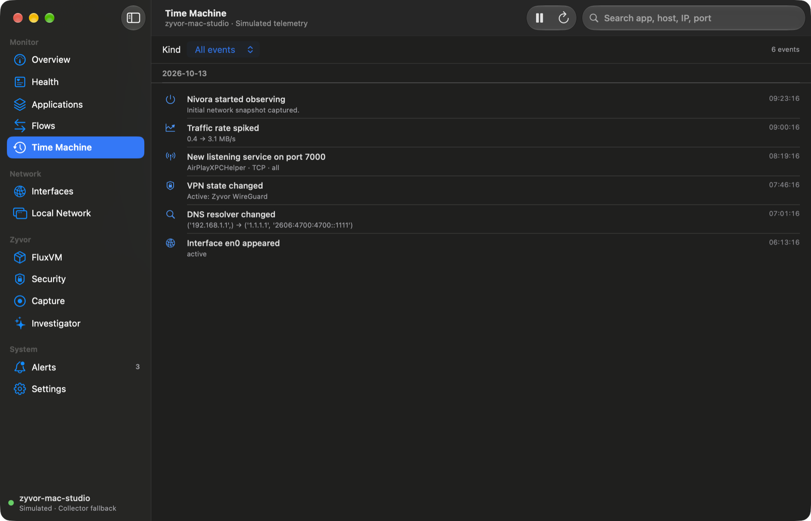

<div align="center">



# Zyvor Nivora

[](https://github.com/zyvorai/zyvor-nivora/actions/workflows/ci.yml)
[](LICENSE)
[](docs/TESTING.md)
[](agent/nivora.py)
[](#privacy-and-safety)



### See every connection on your Mac.

**Mac-native application and network intelligence.** Which app is talking to what, over which interface: per-app flows, DNS, routes, VPNs, listeners and FluxVM workloads, in a native SwiftUI app with a dependency-free collector. Local-first, observe-first.

**macOS only** · **Local-first** · **Observe-first** · **Live per-app bandwidth** · **0–100 health** · **FluxVM aware**

🎮 **[Live demo](https://zyvorai.github.io/zyvor-nivora/demo/)** · 🌐 **[Site](https://zyvorai.github.io/zyvor-nivora/)** · 🚀 **[Quickstart](#quickstart)** · 🧩 **[How it fits](#how-it-fits-together)** · 🔒 **[Privacy](#privacy-and-safety)** · 📖 **[API](docs/API.md)**

</div>

## Why Nivora

| When this happens | Nivora gives you |
| --- | --- |
| "Something is eating my bandwidth" and Activity Monitor only shows a total | **Live ↓/↑ per application**, grouped the way you think about apps, with an inspector for every app and flow |
| "What is this connection to `17.253.x.x`?" | The owning app, remote endpoint, interface (Wi-Fi, VPN, virtual), RTT and every other flow to the same host |
| "Did my VPN or DNS just change?" | A **Time Machine** of interface, DNS, route, VPN and listener changes, kept in SQLite |
| "Is the network actually healthy?" | A **0–100 score** with explained components (route, DNS, latency, interfaces, safety) and a local, offline investigator |
| "I need to hand this to someone" | **CSV / JSON / NDJSON exports** of the current filter, optionally redacted of private IPs, MACs, SSID and hostname |
| You run VMs or sandboxes with FluxVM | Workloads beside host traffic through FluxVM's local REST API |

## See it

**[Try the live demo](https://zyvorai.github.io/zyvor-nivora/demo/)**: the real dashboard running in your browser on simulated telemetry. Nothing to install, nothing leaves the page.



| Light | Dark |
| --- | --- |
|  |  |
|  |  |
|  |  |
|  |  |

*Every image is the native app's built-in **simulated telemetry** (host `zyvor-mac-studio`). They are real window captures from `./scripts/shots-native.sh`.*

## Quickstart

```bash
# 1. Try it with simulated data, no install
python3 agent/nivora.py --demo

# 2. Monitor this Mac (dashboard + API on 127.0.0.1:9857)
python3 agent/nivora.py

# 3. Or the native app (needs Xcode and xcodegen)
brew install xcodegen
./scripts/build-native.sh
open native/build/Build/Products/Release/Nivora.app
```

The collector prints a URL with a one-time token in the fragment; the page reads it and removes it from the address bar. The native app starts its bundled collector on loopback with a random in-memory token.

**Free for personal, non-business use. Business use needs a licence: ₹299 including GST (about US$2.99), one-time.** Two paid builds: the **signed and notarized** app (opens without a Gatekeeper warning; no content filter or capture helper, which need Apple entitlements we do not have) and the unsigned **developer build** (includes the content-filter and capture-helper code; Apple's restrictions mean it cannot be notarized here, you must sign it yourself to activate them, and those parts are compile-verified only). [Buy the signed app](https://rzp.io/rzp/ZlsmLxuC) · [Buy the developer build](https://rzp.io/rzp/6Qi1kpHv) · [Licence terms](docs/COMMERCIAL-LICENSE.md). Companies with several entities: sales@zyvor.dev.

The free builds from GitHub Releases are **unsigned and not notarised**: macOS Gatekeeper will block the first launch (*"cannot be opened because the developer cannot be verified"*). Building it yourself avoids this; otherwise use **System Settings → Privacy & Security → Open Anyway**. Step-by-step instructions are in [docs/INSTALL.md](docs/INSTALL.md). The content filter and capture helper additionally need a signed, provisioned build (see [Maturity](#maturity)).

<details>
<summary><b>Install as a per-user service, CLI and more</b></summary>

```bash
./scripts/install-macos.sh          # launchd agent, token in Login Keychain
./scripts/uninstall-macos.sh

python3 agent/nivoractl.py status
python3 agent/nivoractl.py flows --filter 'app:Safari port:443 >1mbps'
python3 agent/nivoractl.py rule-add --action block --domain example.com --duration 900
```

`nivoractl` reads `NIVORA_TOKEN`; on macOS it also looks for the token stored by `install-macos.sh`.

</details>

## How it fits together

```text
              Nivora.app (SwiftUI)  /  browser dashboard
                            │   HTTP JSON · 127.0.0.1 · bearer token
                        nivora.py   (Python stdlib only)
            ┌───────────────┼────────────────┐
     NetworkExtension    nettop · lsof     FluxVM :7788
     content filter     ifconfig · netstat  VMs · sandboxes
     (signed, opt-in)   scutil · arp · ndp
            └───────────────┴──────→ SQLite time machine
```

| Visibility tier | Needs | Gives you |
| --- | --- | --- |
| **Collector fallback** | Nothing: works today | Per-app flows and byte counters (`nettop`/`lsof`), interfaces, routes, DNS, VPNs, neighbours, listeners |
| **Content filter** | Signed build + Apple entitlement | Per-flow app attribution and byte reports from the system |
| **Capture helper** | Signed build + your approval | Headers-only `.pcap` of one flow, host or app, for a few minutes |

The dashboard, native app, CLI and exports all use one JSON schema regardless of tier. See [Architecture](docs/ARCHITECTURE.md).

## Features

| Pane | What it does |
| --- | --- |
| **Overview** | Health, ↓/↑ rate, connections, throughput chart, top apps with sparklines, what changed, what needs attention |
| **Applications / Flows** | Sortable tables, **filter grammar** with chips and saved views, grouping by app/host/interface, baseline compare, flow inspector, CSV/JSON export |
| **Health** | Explained 0–100 score and history |
| **Time Machine** | Day-grouped history of interface, DNS, route, VPN, listener, new-device and traffic changes, filterable by kind; diff any two points in time |
| **Interfaces / Local Network** | Wi-Fi, Ethernet, VPN and virtual interfaces; ARP/NDP neighbours; listeners and exposure |
| **FluxVM** | VMs and sandboxes beside host traffic |
| **Security** | Observe-first findings, leased rules (block rules expire after an hour), shadow rules that count what a block would match, policy-as-code (dry-run by default) |
| **Insights** | Per-app trust score, privacy report card, situation profiles, multi-Mac fleet, sandbox/VM egress, path check and incident narrative |
| **Capture** | Opt-in, headers-only packet capture through a separately approved helper; pcap download |
| **Investigator** | Deterministic, offline answers ("Which app uploaded the most?") |

Filter syntax, shared by the native app, dashboard, API and CLI:

```text
app:Safari  host:example.com  port:443  port:8000-9000  proto:tcp  iface:en0
state:established  source:nettop  >1mbps  <500kbps  !iface:lo0  app:"Google Chrome"
```

Keyboard: `⌘1…⌘9` panes · `⌘/` shortcuts · `⌘R` refresh · `⌘P` pause · `⇧⌘1/2` live/demo data.

## Privacy and safety

- **Local-first**: no account, no cloud, no telemetry upload. The API binds to loopback with a bearer token.
- **Observe-first**: rules default to observe; block rules are one-hour leases and only take effect through the signed content filter.
- **No payloads**: flow metadata only. The single exception, [packet capture](docs/CAPTURE.md), is off until you start it, headers-only by default (96 bytes), capped (≤ 5 min, ≤ 64 MB), root-only on disk and deleted after 24 hours.
- **Read-only collection**: the fallback runs read-only macOS commands; API mutations are limited to Nivora's own rule file.
- Exports can be **redacted** (private IPs, MACs, SSID, hostname become salted hash tokens).

See [SECURITY.md](SECURITY.md).

## Maturity

| Area | Status |
| --- | --- |
| Collector, API, dashboard, CLI, exports, filters | Built and tested in CI (Python, Node) |
| Native app (SwiftUI) and unit tests | Builds and runs unsigned with Xcode; XCTest suite passes |
| Content filter (system extension) and capture helper | **Compile-verified only.** Signing, entitlement approval, activation and root capture are untested; they need a provisioned, signed Mac |
| Insights pane, Shortcuts/Siri actions, widget | Build and unit tests pass; the widget in the macOS widget gallery and the Shortcuts/Siri phrases are **not exercised** |
| Release DMG from GitHub (free) | Ad-hoc sealed, unsigned by a Developer ID, not notarised (Gatekeeper asks for Open Anyway) |
| Signed and notarized build (`scripts/package-signed.sh`) | Verified on macOS 27.2, Apple silicon: Apple notarization accepted, stapled, Gatekeeper accepts the DMG and the app (also with a download quarantine flag), the app launches and its bundled collector serves data the app decodes (checked against a real FluxVM). It deliberately leaves out the content filter and capture helper. Not exercised: other macOS versions, Intel (the app is arm64 only) |

## Documentation

| Doc | Topic |
| --- | --- |
| [docs/INSTALL.md](docs/INSTALL.md) | Install, Gatekeeper and unsigned builds |
| [docs/ARCHITECTURE.md](docs/ARCHITECTURE.md) | Components and data flow |
| [docs/API.md](docs/API.md) | HTTP endpoints, filter grammar, exports |
| [docs/CAPTURE.md](docs/CAPTURE.md) | Packet-capture design and guarantees |
| [docs/NETWORKEXTENSION.md](docs/NETWORKEXTENSION.md) | Content filter, signing and entitlements |
| [docs/FLUXVM.md](docs/FLUXVM.md) | FluxVM integration |
| [docs/UX-CONTRACT.md](docs/UX-CONTRACT.md) | Design tokens and interaction rules |
| [docs/TESTING.md](docs/TESTING.md) | Test suite and release steps |
| [CONTRIBUTING.md](CONTRIBUTING.md) · [CHANGELOG.md](CHANGELOG.md) | Contributing and history |

## Test

```bash
./scripts/test.sh
```

Runs the Python suite, web and demo tests, the static-site check, plist and Swift syntax gates and a demo-collector run. The native app and unit tests build with `./scripts/build-native.sh`.

## License

Nivora is licensed under the **Business Source License 1.1**.

You may use Nivora for development, evaluation, testing, demonstration, and other non-production purposes under the terms of the BSL.

**Production and commercial deployments require a commercial license from Zyvor AI Labs Private Limited.**

Each version converts to the **Apache License 2.0** four years after its initial release under the Business Source License.

See [LICENSE](LICENSE) and [NOTICE](NOTICE).

Copyright © 2026 Zyvor AI Labs Private Limited · [zyvor.dev](https://zyvor.dev)

<div align="center">

**See every connection on your Mac.** · [Quickstart](#quickstart) · [Security](SECURITY.md) · [Changelog](CHANGELOG.md)

</div>
